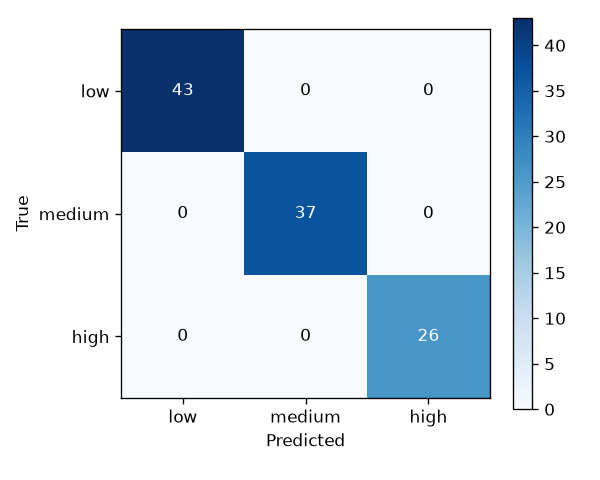
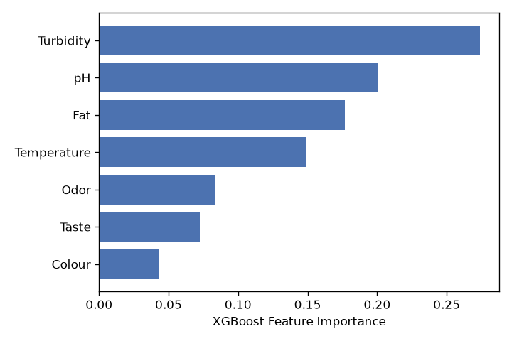

# 牛奶品质分级模型 · 评估报告

- 训练时间：2026-10-15T11:02:08
- 样本量：1059 条（8:1:1 分层抽样）
- 模型：XGBoost (sklearn Pipeline: StandardScaler + XGBClassifier)

## 1. 超参数（GridSearchCV 5折 CV 择优）

| 参数 | 取值 |
|---|---|
| colsample_bytree | 0.8 |
| learning_rate | 0.2 |
| max_depth | 3 |
| n_estimators | 300 |
| subsample | 0.8 |

CV 最佳宏平均 F1：**0.9976**

## 2. 测试集指标

| 指标 | 数值 | 任务书目标 | 是否达标 |
|---|---|---|---|
| 总体准确率 | 100.0% | ≥85% | ✅ |
| 宏平均 F1 | 1.000 | — | — |
| 最低类别 F1 | 1.000 | ≥0.80 | ✅ |

### 各类别 F1

| 等级 | F1 |
|---|---|
| low | 1.000 |
| medium | 1.000 |
| high | 1.000 |

## 3. 混淆矩阵（测试集）

## 4. 特征重要性

| 特征 | 重要性 |
|---|---|
| Turbidity | 0.2740 |
| pH | 0.2004 |
| Fat | 0.1768 |
| Temperature | 0.1492 |
| Odor | 0.0835 |
| Taste | 0.0726 |
| Colour | 0.0435 |

## 5. 结论

模型在测试集上总体准确率与各类别 F1 均远超任务书要求（≥85% / ≥0.80），可行性已验证。次要特征（Taste/Odor/Colour）重要性较低，可作为后续特征筛选的参考。